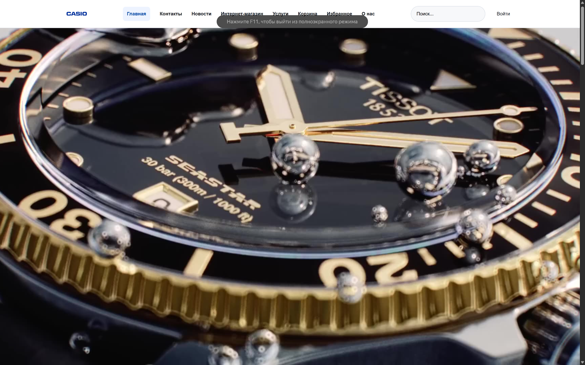
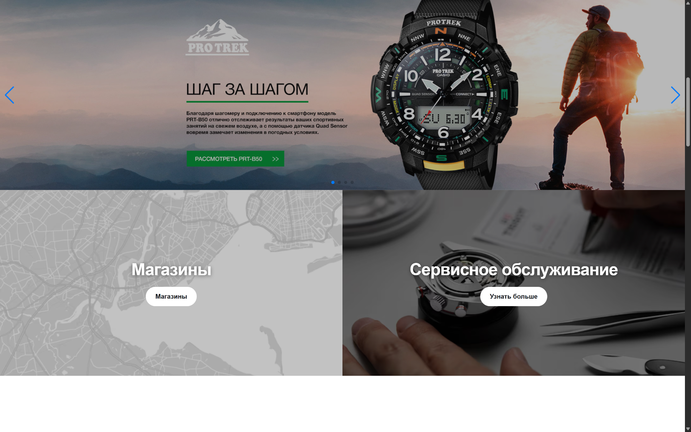
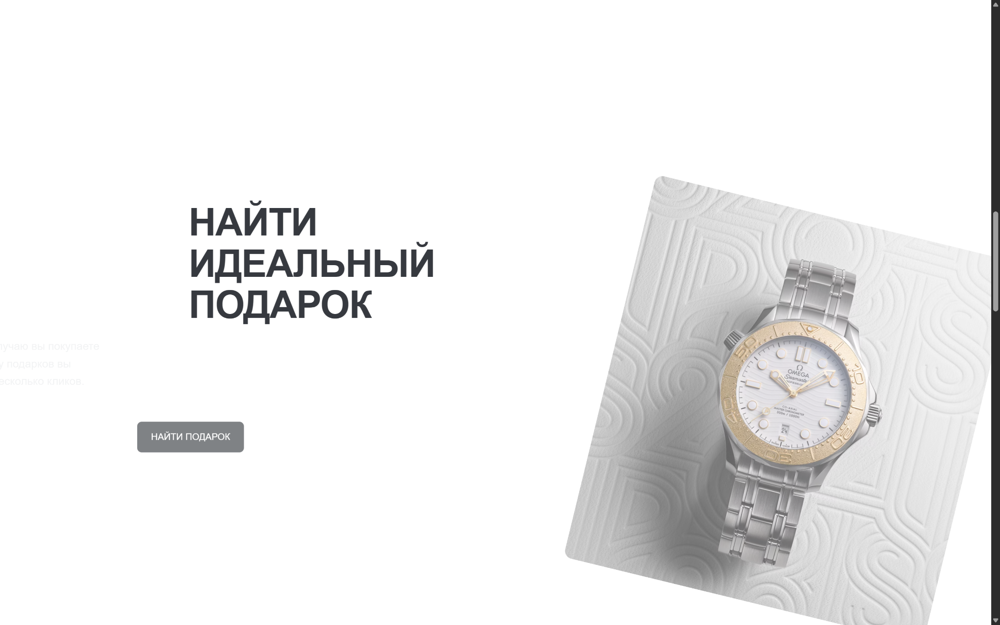
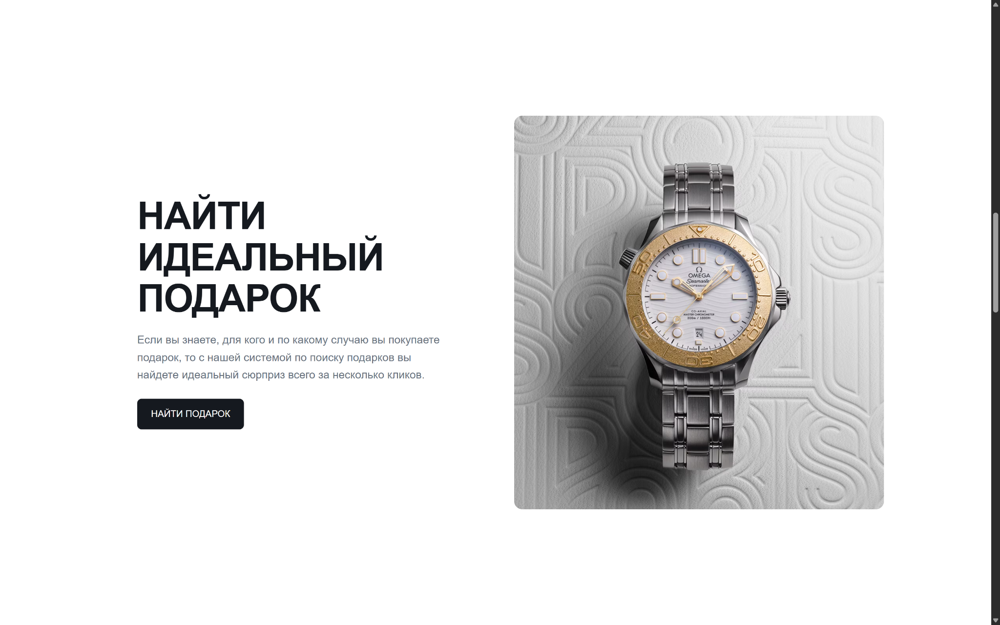
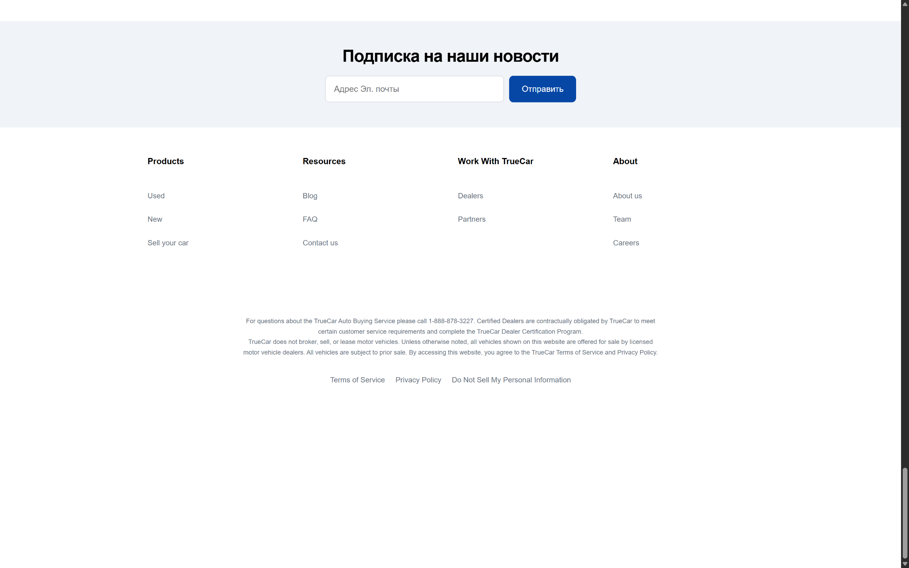
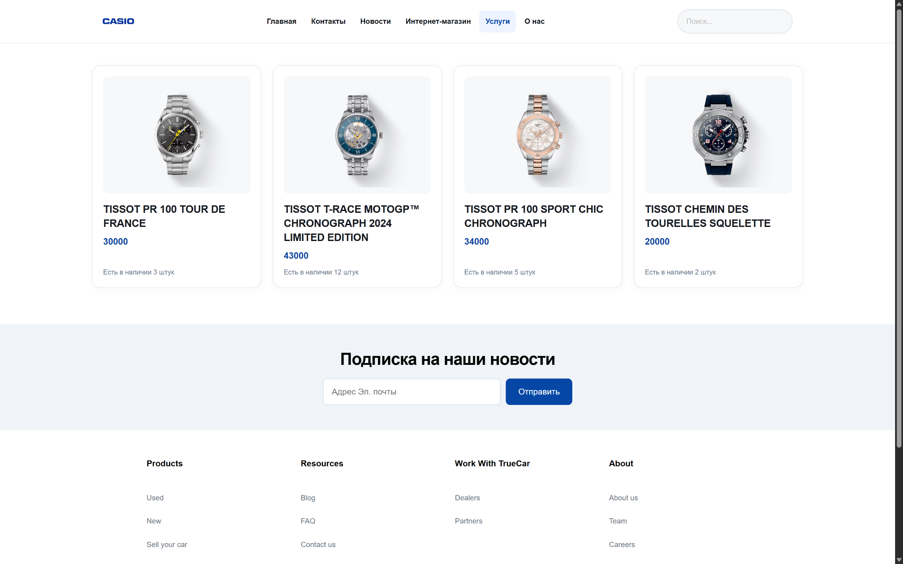
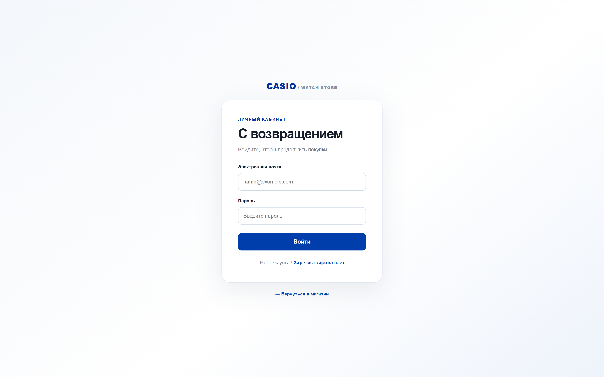

# CASIO Watch Store

Учебный веб-проект интернет-магазина наручных часов с интерфейсом каталога и серверной частью на PHP.

## Технологии

- **PHP** — серверная логика
- **Microsoft SQL Server** — база данных
- **SQL Server Management Studio (SSMS)** — работа с базой данных
- **HTML, CSS, JavaScript** — интерфейс и интерактивные элементы

## Возможности

В проекте представлены:

- Главная страница с рекламными баннерами и слайдером
- Каталог часов с карточками товаров, ценами и информацией о наличии
- Страницы входа и регистрации
- Разделы корзины и избранного
- Поиск, навигация и информационные страницы
- Анимации и интерактивные элементы интерфейса

> Проект создан в учебных целях. Наличие элемента интерфейса не обязательно означает, что соответствующая функция полностью реализована на сервере.

## Скриншоты

### 1. Главная страница — часы CASIO

### 2. Рекламный слайдер

### 3. Подбор подарка

### 4. Каталог и подборки

### 5. Карточки товаров

### 6. Подвал сайта

### 7. Форма входа

### 8. Страница магазина

### 9. Дополнительный экран

## Локальный запуск

1. Установите PHP и веб-сервер, например Apache из XAMPP.
2. Подготовьте Microsoft SQL Server и базу данных проекта.
3. Настройте подключение к SQL Server в локальной конфигурации приложения. Для PHP могут потребоваться драйверы `sqlsrv` и `pdo_sqlsrv` соответствующих версий.
4. Разместите проект в директории веб-сервера и откройте его через `localhost`.

Точные шаги запуска, структура БД и имена конфигурационных файлов зависят от исходного кода проекта и будут уточнены после проверки репозитория.

## Безопасность

Не публикуйте пароли, реальные данные пользователей и локальные файлы конфигурации с секретами. Для примера настроек используйте отдельный файл без секретных значений.

## Статус

Учебный проект для практики веб-разработки и работы с реляционной базой данных.
